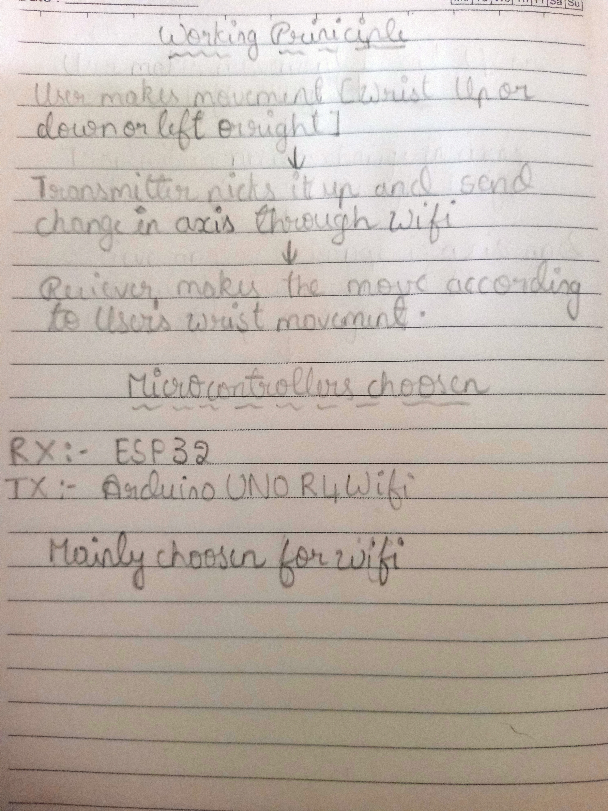
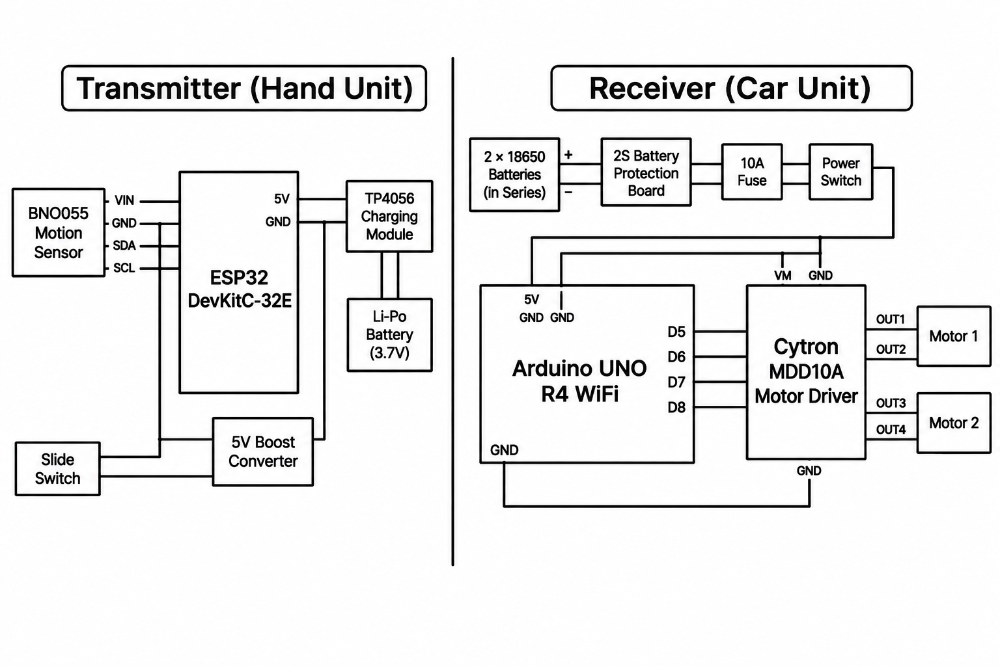

# Journal – Gesture Controlled Car

---

## Day 1 – Project Planning (2 Hours)

On the first day, I got the idea of a gesture-controlled car. I wanted to control the car by moving my hand. Tilting the hand forward would move the car forward, tilting it backward would move it in reverse, and tilting it sideways would control the steering.
Next I thought of how data to be transmitted.I thought how about wifi and choose Arduino Uno R4 as RX and ESP 32 as TX.

---

## Day 2 – Component Selection and Circuit Diagrams (1 Hour 30 Minutes)

On the second day, I selected the components needed for the project. These included an ESP32, BNO055 motion sensor, TP4056 charging module, boost converter, Arduino Uno R4 WiFi (Which I choose before) motor driver and four DC gear motors.

After selecting the components, I prepared separate circuit diagrams for the transmitter and receiver. I also identified the main connections, power supply requirements and function of each component.

---

## Day 3 – Receiver PCB Design (2 Hours 15 minutes)

On the third day, I worked on the receiver PCB.I first created schematic diagram and converted that to PCB completing reciever PCB part.

Next I checked the route using Claude because i don't know how. I was happy when there were no errors.

---

## Day 4 – Transmitter PCB Design (2 Hour 15 Minutes)

On the fourth day, I designed the transmitter PCB. Starting with schematic diagram and I completed PCB of transmitter too.

I again checked routes using Claude like before because I mentioned before.

---

## Day 5 – Chassis Design and 3D Modelling (4 Hours 15 minutes)

On the fifth day, I started designing the car chassis. I planned an orange body (because I like it) with rounded corners, and to fit the receiver PCB and an area for the battery.

I selected yellow TT gear motors and designed suitable motor brackets for them too. During the design, I noticed that the motor voltage rating did not match the original battery selection. So I changed the battery arrangement to two 18650 cells in series and planned to limit the motor power which gave me head ache.

I also designed the chassis lid and added screw positions with heat-set inserts. After checking the 3D model,I thought still code is remaining.

---

## Day 6 – Writing and Checking the Code (2 Hours)

On the sixth day, I worked on the Arduino code for both the transmitter and receiver.

The transmitter code reads the hand movements using the BNO055 sensor and sends the movement data wirelessly. The receiver code processes the received data and controls the motors.

I am not sure about code because I didn't test it but I used Claude to fix some bugs detected by itself.

---

## Day 7 – README and BOM Preparation (3 Hours)

On the 7th Day, I prepared the project documentation. I wrote the README file.

I also prepared the Bill of Materials (BOM), including component names, quantities and estimated prices in Indian rupees.

During the final review, I noticed that the selected motor driver was too large for the available chassis space. So I changed the motor driver from Cytron MDD20A to MDD10A and updated the related board information which was also an head ache.

---

## Day 8 - Enclosure For Transmitter (3 Hours 15 minutes)

I forgotten to build enclosure for Tx so I build one. I used Velcro straps to attach it to y hand and i updates Bill of Materials. Finally at last I completed this project by reviewing once again.

---
